# RedmineTUI

Терминальный клиент Redmine. Ходит напрямую в REST API и рисует заявки текстом
в терминале, так что читать тикеты, менять статус, списывать время и постить
SQL-комментарии можно без вкладки браузера.


## Скриншоты

Демонстрация на локальном стенде: заявки, имена и данные вымышлены.

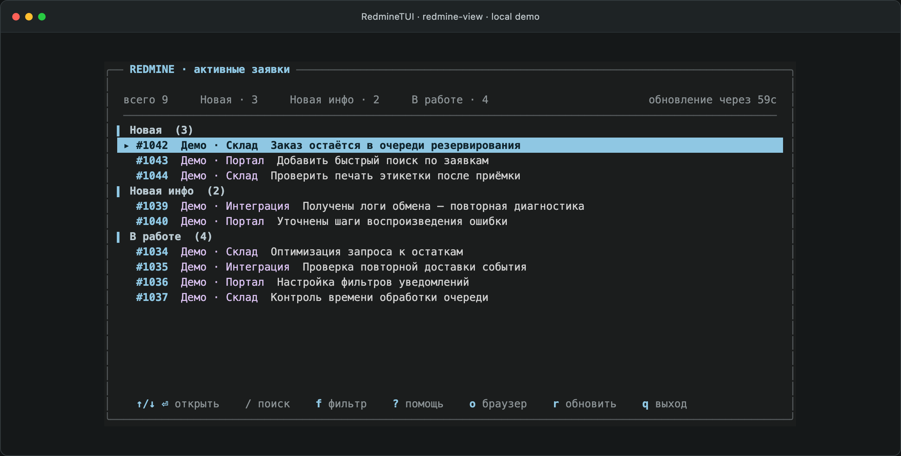

<details>
<summary>Поиск, карточка заявки, SQL, редактор и другие экраны</summary>

### Поиск по проекту

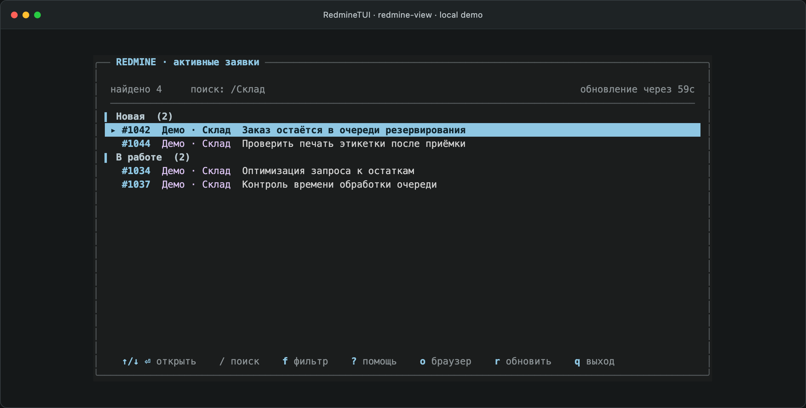

### Фильтр по статусу

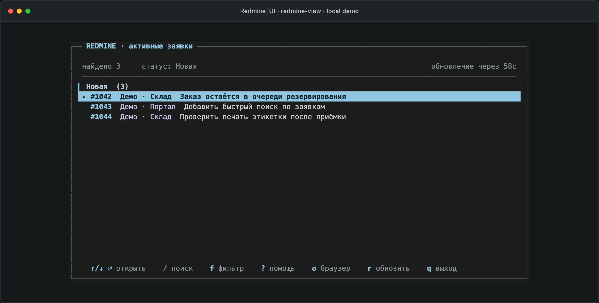

### Встроенная справка

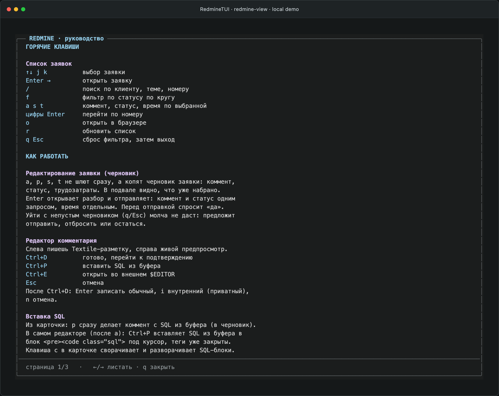

### Карточка заявки и SQL

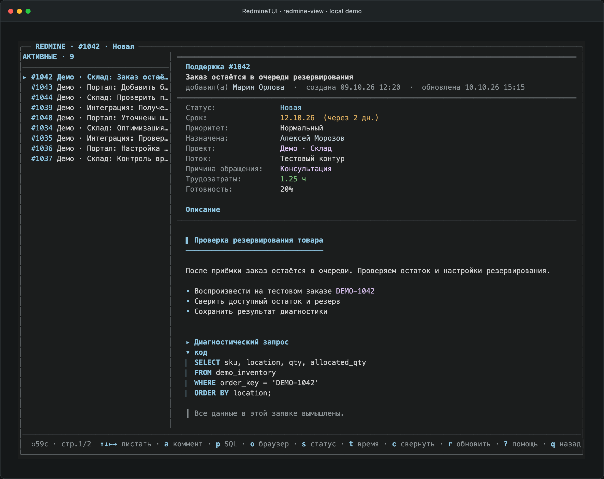

### История, внутренний комментарий и SQL

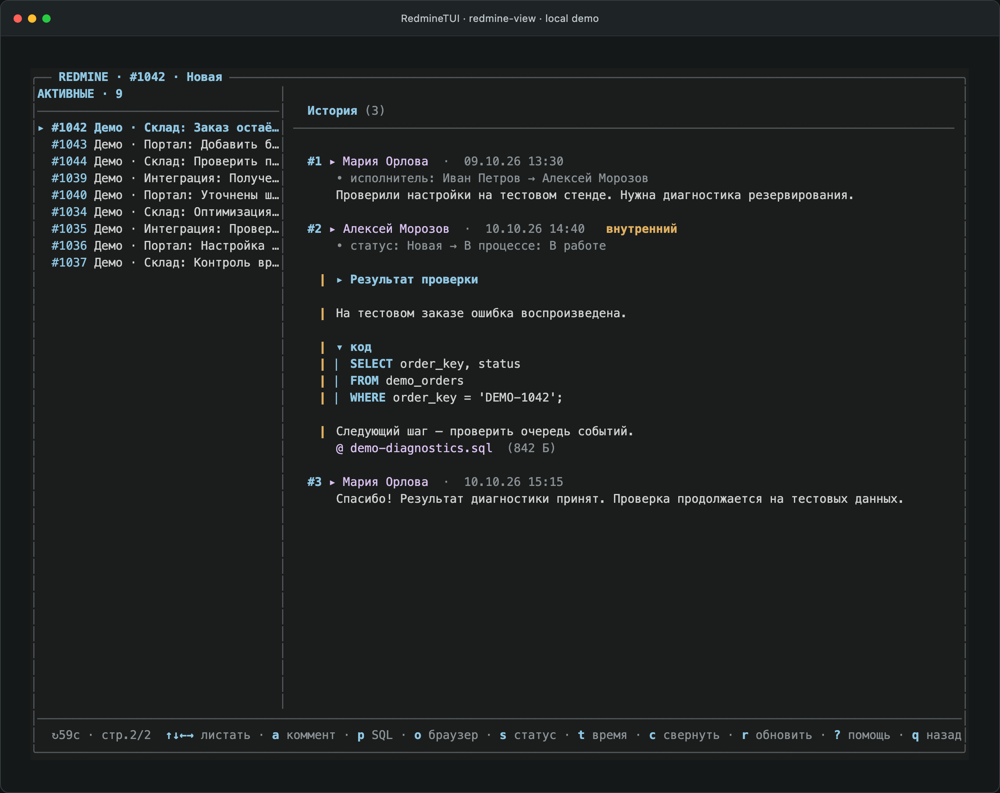

### Свёрнутые SQL-блоки

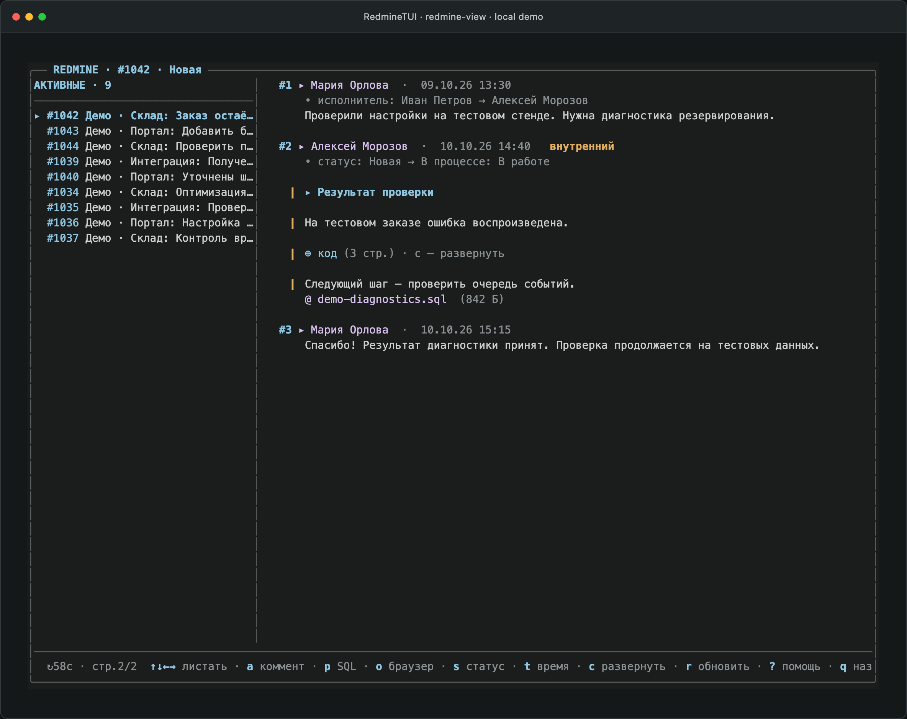

### Редактор комментария и живой предпросмотр

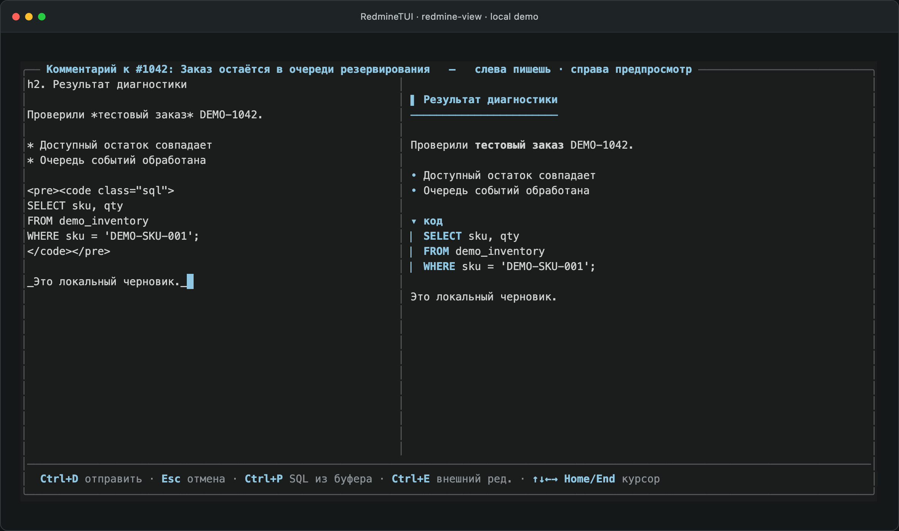

### Комментарий, статус и время в черновике

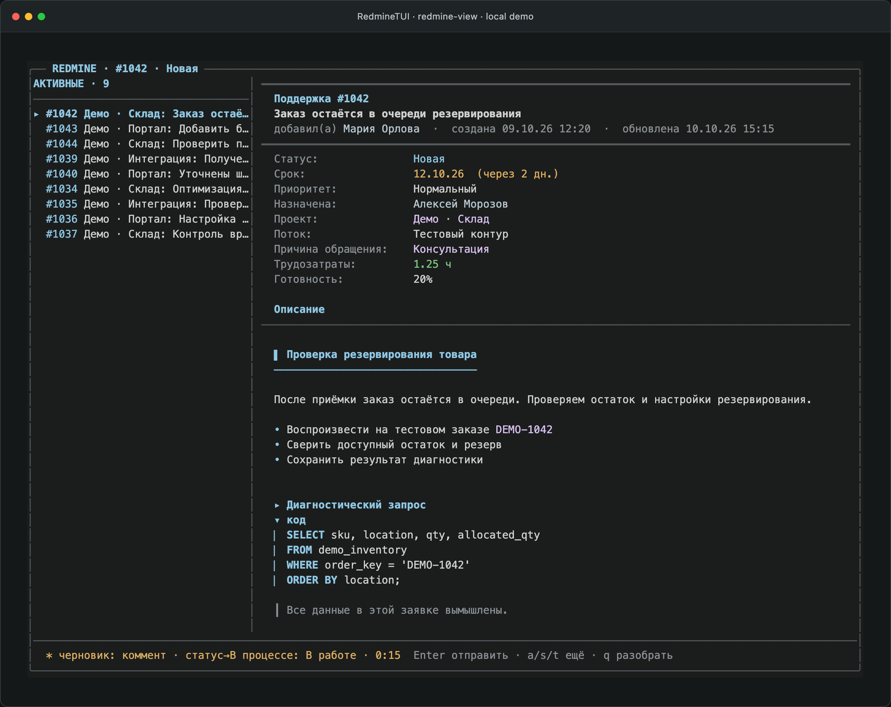

### Просмотр черновика перед подтверждением

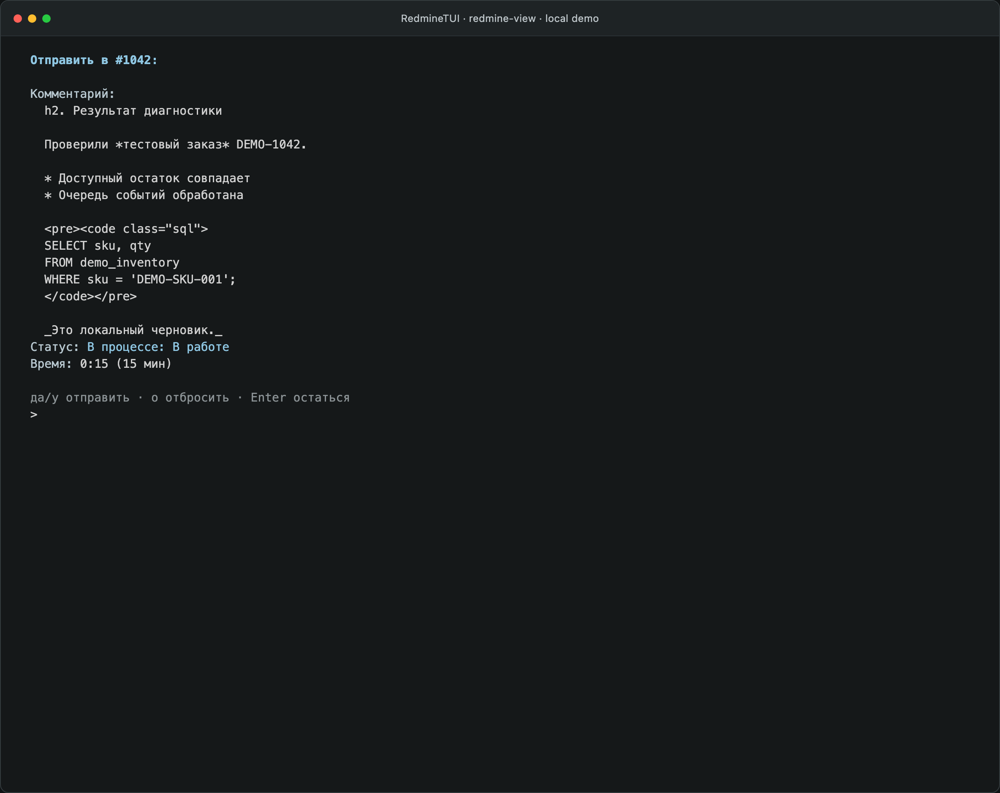

### Карточка в узком терминале

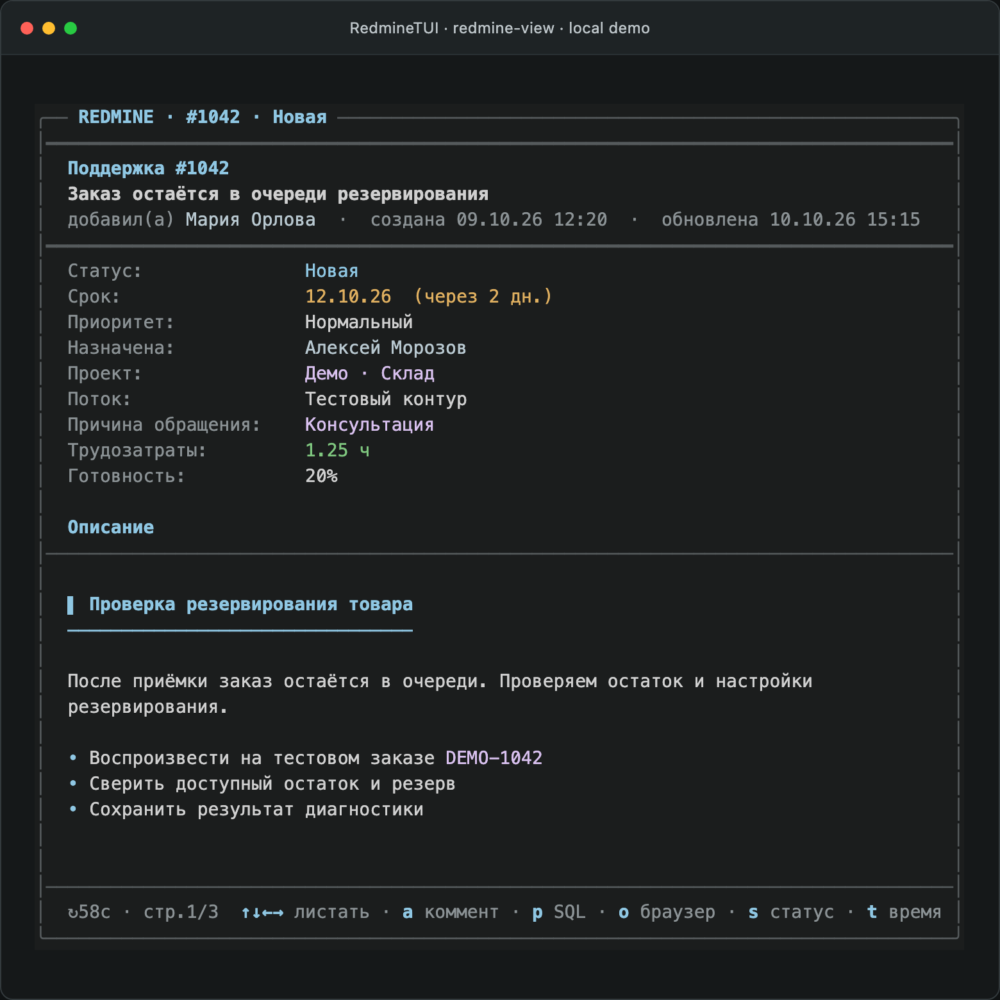

### Ошибка подключения

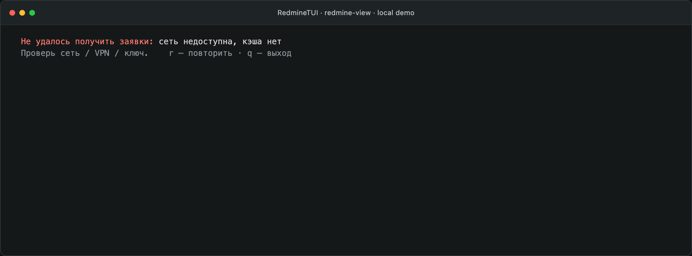

### Пустой список

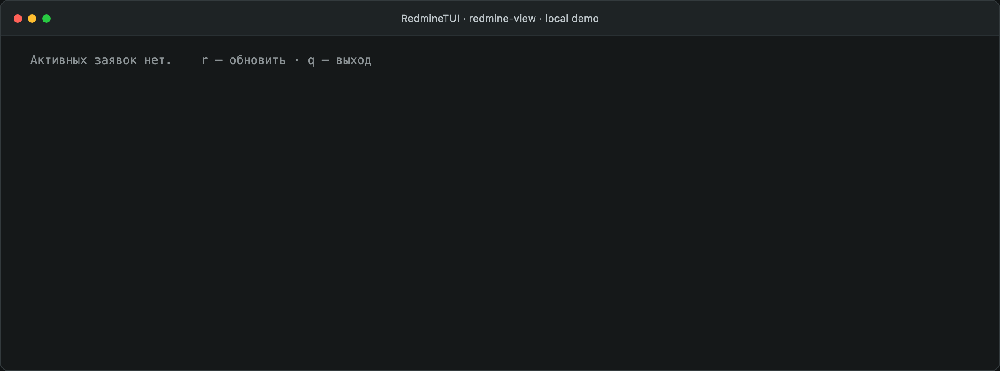

</details>

## Что внутри

- **redmine-view** - интерактивный TUI: список заявок плюс карточка со всей
  историей, вложениями и подсветкой SQL. Правки (коммент, статус, время) копятся
  в черновик и уходят разом. Справка и описание по клавише `?`.
- **redmine-shift** - собирает смену (твои заявки за сегодня и вчера) в буфер.
- **redmine-notify** - фоновый демон (systemd --user): опрашивает Redmine и шлёт
  уведомления с кликабельным «открыть заявку».
- **redmine-list / redmine-issue / redmine-open** — мелкие хелперы для меню и
  быстрых открытий заявки.
- **redmine_tui.py** — общий движок (REST-клиент, тема, клеточный рендер
  терминала, рендер заявок). **redmine_conf.py** — общий загрузчик конфига.

## Зависимости

Python 3, `jq`, `curl`, `secret-tool` (libsecret). Для демона уведомлений:
`python-gobject` и libnotify. Опционально: `chafa` (превью картинок в sixel,
лучше всего в терминале foot), `wl-clipboard`, `fuzzel`.

## Установка

```sh
git clone https://github.com/Mutata56/RedmineTUI.git ~/RedmineTUI
cd ~/RedmineTUI
./install.sh
```

`install.sh` делает симлинки `bin/*` в `~/.local/bin` и создаёт конфиги из
шаблонов в `config/` (существующие не трогает).

## Конфигурация

Всё, что специфично для  установки (хост, id проектов, имена клиентов),
лежит в `~/.config` и не коммитится. В репозитории только шаблоны `*.example`.

| Файл | Из шаблона | Что хранит |
|------|------------|------------|
| `~/.config/redmine-tui.conf` | `config/redmine-tui.conf.example` | базовый URL, activity id, источники списка |
| `~/.config/redmine-notify/config` | `config/redmine-notify.config.example` | url, источники, статусы, частота опроса |
| `~/.config/redmine-shift-ban.txt` | `config/redmine-shift-ban.txt.example` | токены фильтра смены, по одному в строке |

API-ключ в системном keyring:

```sh
secret-tool store --label='Redmine API' service redmine-notify
```

## Демон уведомлений

```sh
cp systemd/redmine-notify.service ~/.config/systemd/user/
systemctl --user enable --now redmine-notify
journalctl --user -u redmine-notify -f
```

## Лицензия

MIT, см. [LICENSE](LICENSE).
